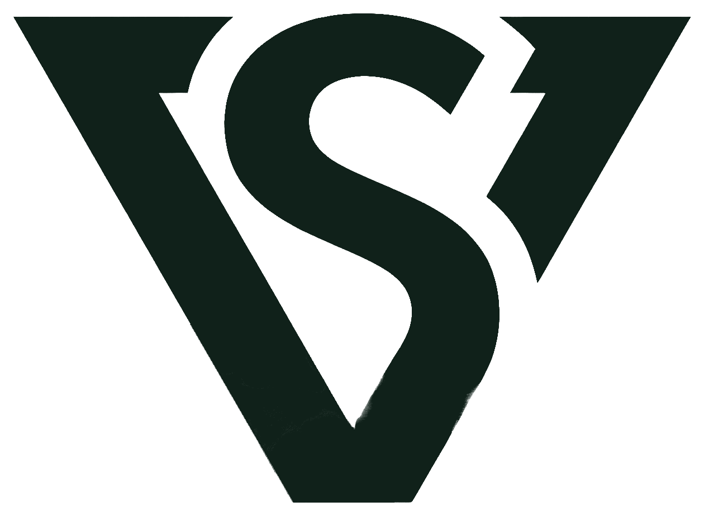

# VS Studio

<div align="center">
  
  <p><strong>Bespoke websites, visual brands, and autonomous AI agents.</strong></p>
  <p>An independent two-founder design & engineering studio founded by <strong>Vishnu Vardhan R G</strong> and <strong>Sriram S</strong>.</p>

  <p>
    <a href="mailto:vsstudioai@gmail.com">Contact Us</a> •
    <a href="#core-capabilities">Capabilities</a> •
    <a href="#tech-stack">Tech Stack</a> •
    <a href="#design-system">Design System</a> •
    <a href="#getting-started">Getting Started</a>
  </p>
</div>

---

## Overview

**VS Studio** is an independent studio operated directly by two hackathon builders and CSE engineers. We combine editorial aesthetics with production-grade engineering to deliver fast web applications, memorable brand systems, and intelligent automated workflows.

- **Zero Agency Overhead**: Clients collaborate directly with the senior founders who design and code every deliverable.
- **Sprint-Driven Delivery**: Typical turnaround from kickoff to deployment is 2 to 4 weeks.
- **Editorial & Performance Focus**: Accessible semantic markup, sub-second load times, and custom micro-interactions.

---

## Core Capabilities

| Pillar | Focus Areas | Key Deliverables |
| :--- | :--- | :--- |
| **Website Design & Dev** | Modern web systems, fullstack apps, editorial marketing sites | Next.js / Vite + React, Tailwind CSS, high-performance responsive layouts, WCAG AA compliance |
| **Logo & Brand Identity** | Distinct visual systems, custom typography pairings, design tokens | Vector marks, color palettes, typographic guidelines, design system tokens |
| **AI Agents & Automation** | Autonomous agent pipelines, CRM & email workflows, API bridges | Python agent workflows, LLM integrations, webhook pipelines, automated RFP triage |

---

## Tech Stack

- **Framework**: [React 18](https://react.dev/) + [Vite](https://vitejs.dev/) + [TypeScript](https://www.typescriptlang.org/)
- **Styling**: [Tailwind CSS](https://tailwindcss.com/) + Custom CSS Design Tokens
- **Motion & Interactions**: [GSAP (GreenSock)](https://gsap.com/) + ScrollTrigger (custom 3D masked text reveals, parallax drift)
- **Icons**: [Lucide React](https://lucide.dev/)
- **Backend / Database Ready**: [Supabase](https://supabase.com/) (PostgreSQL, Row Level Security, Auth)
- **Routing**: [React Router DOM v6](https://reactrouter.com/)

---

## Design System & Tokens

VS Studio strictly follows an editorial green palette and refined typography:

### Color Palette
- **White** (`#FFFFFF`): Primary background card surface
- **Paper** (`#F6F8F5`): Canvas body background
- **Mint** (`#E4F7EB`): Subtle accent pill highlights & container fills
- **Sage** (`#9EDBB3`): Fine borders, dividers, and decorative rings
- **Green** (`#1DB954`): Primary action buttons, badges, and focus rings
- **Forest** (`#0D2B1F`): Primary headings, dark section banners, and footer
- **Ink** (`#0B1E16`): High-contrast readable body text

### Typography
- **Headings**: `Young Serif` (editorial serif with warm curves)
- **Body & UI**: `Schibsted Grotesk` (clean, highly readable sans-serif)

---

## Key Features

- **Text Reveal Headlines**: Word-by-word masked 3D curtain reveals powered by GSAP and ScrollTrigger.
- **4-Step Client Intake Flow**: Structured project inquiry with budget ranges, timeline selectors, client-side validation, honeypot spam protection, and local draft recovery.
- **Standalone Brand Mark**: Custom vector brand emblem integrated across navigation, footer, and badges.
- **Motion Accessibility**: Full `prefers-reduced-motion` detection and fallbacks across all GSAP timelines.
- **Responsive Architecture**: Pixel-perfect layout across mobile (360px), tablet (768px), and desktop (1280px+).

---

## Project Structure

```text
├── public/
│   ├── favicon.png             # Studio browser favicon
│   ├── logo.png                # Transparent dark logo emblem
│   └── logo-white.png          # Transparent white logo emblem
├── src/
│   ├── components/
│   │   ├── inquiry/            # MultiStepInquiryForm & validation
│   │   ├── motion/             # TextReveal, HeroCircles, Parallax
│   │   ├── navigation/         # Navbar, Footer
│   │   └── ui/                 # StudioLogo, reusable badges
│   ├── lib/
│   │   ├── gsap.ts             # GSAP & ScrollTrigger registration
│   │   └── supabase.ts         # Supabase client client initialization
│   ├── pages/
│   │   └── public/             # Home, Services, Portfolio, About, Contact
│   ├── types/                  # Inquiry & portfolio TypeScript definitions
│   ├── App.tsx                 # Routes and main layout
│   ├── index.css               # Design tokens and base styles
│   └── main.tsx                # React entrypoint
├── tailwind.config.js          # Studio palette & animation extensions
├── vite.config.ts              # Vite configuration with dependency optimization
└── tsconfig.json               # TypeScript compiler config
```

---

## Getting Started

### Prerequisites
- Node.js (v18.0.0 or higher)
- npm or pnpm / yarn

### Installation
```bash
# 1. Clone repository
git clone https://github.com/vishnu7443/VSSTUDIO.git
cd VSSTUDIO

# 2. Install dependencies
npm install

# 3. Configure environment variables (optional for local mock mode)
cp .env.example .env

# 4. Start local development server
npm run dev
```

The application will be live at `http://localhost:5173/`.

### Production Build
```bash
# Typecheck and compile production bundle
npm run build

# Preview production build locally
npm run preview
```

---

## Founders

- **Vishnu Vardhan R G** — Co-Founder & Lead Engineer (3rd Year CSE, Hackathon Enthusiast)
- **Sriram S** — Co-Founder & Systems Architect (2nd Year CSE, Hackathon Enthusiast)

---

## Contact & Inquiries

For project engagements, scopes, and proposals:
- **Email**: [vsstudioai@gmail.com](mailto:vsstudioai@gmail.com)
- **Inquiry Portal**: [VS Studio Inquiry Form](http://localhost:5173/contact)
- **GitHub**: [@vishnu7443](https://github.com/vishnu7443)
